# OncoGene Explorer

**Leakage-safe analysis of breast tumor vs. paired adjacent-normal gene expression, with an interactive dashboard.**

OncoGene Explorer is an end-to-end, reproducible computational-biology project built on public microarray
data (NCBI GEO [GSE109169](https://www.ncbi.nlm.nih.gov/geo/query/acc.cgi?acc=GSE109169)). It downloads and
validates the data, runs paired differential-expression and pathway analyses, trains and compares classifiers
with nested **patient-grouped** cross-validation, interprets what the models learned, and presents everything
in a seven-page Streamlit dashboard.

> **Research and education only.** This is not a clinically validated diagnostic, screening or treatment tool.
> All results describe one public cohort of 25 patients.

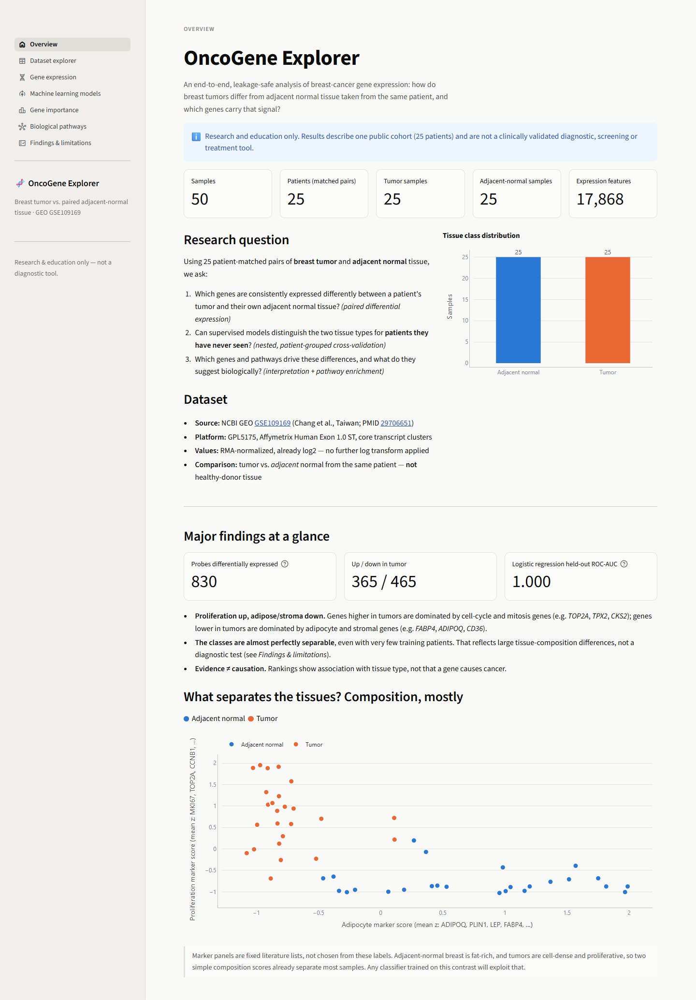

---

## Contents
1. [Biological motivation](#biological-motivation)
2. [Research question](#research-question)
3. [Technical architecture](#technical-architecture)
4. [Dataset](#dataset)
5. [Installation](#installation)
6. [Reproducing the analysis](#reproducing-the-analysis)
7. [Running the dashboard](#running-the-dashboard)
8. [Analytical methods](#analytical-methods)
9. [Results](#results)
10. [Dashboard screenshots & demo](#dashboard-screenshots--demo)
11. [Biological findings and limitations](#biological-findings-and-limitations)
12. [Future improvements](#future-improvements)
13. [Testing](#testing)
14. [Citations and acknowledgments](#citations-and-acknowledgments)

---

## Biological motivation

Cancer changes which genes a tissue expresses. Tumors switch on cell-division machinery, remodel the surrounding
matrix and recruit immune cells, and they displace the fat-rich tissue of the normal breast. Measuring the
expression of ~18,000 genes in a tumor and in normal tissue *from the same patient* is a powerful design,
because each patient serves as their own control.

The data also invite a classic mistake. With 50 samples and 18,000 features, a careless pipeline can reach
"100% accuracy" through **data leakage**: tuning, scaling or selecting genes using samples that later appear in
the test set, or letting a patient's tumor sit in the training set while their normal sample is in the test set.
This project is built around avoiding those mistakes and reporting uncertainty honestly.

## Research question

Using 25 matched pairs of breast tumor and adjacent normal tissue:

1. Which genes differ **consistently within patients** between tumor and adjacent normal tissue?
2. Can supervised models distinguish the tissue types **for patients they have never seen**, and how
   certain can we be with only 25 patients?
3. Which genes and pathways drive the difference, and how much of it is **tissue composition** rather
   than malignancy itself?

## Technical architecture

```text
GEO (series matrix, GPL5175 table)  +  Enrichr gene-set libraries (Reactome, GO-BP)
        │  oncogene download         (checksummed: data/raw/provenance.json)
        ▼
parse → validate (15 checks) → label-free filters         oncogene preprocess
        │   data/processed/expression_matrix.parquet, data/metadata/*.csv
        ▼
EDA · paired DE (t / Wilcoxon, BH-FDR) · pathway ORA        oncogene analyze
        ▼
nested patient-grouped CV  ──►  metrics, OOF predictions,     oncogene train
  impute → top-variance → scale → k-best → model                held-out permutation importance,
  (all refit inside every training fold)                        learning curve, final models + cards
        ▼
static figures · Markdown research summary                    oncogene figures / report
        ▼
Streamlit dashboard (reads artifacts only; never trains or unpickles models)
```

```text
oncogene-explorer/
├── configs/experiment.yaml        # every tunable parameter, seeds, grids, thresholds
├── src/oncogene/
│   ├── data/          download.py · load.py · validate.py
│   ├── preprocessing/ cleaning.py · transforms.py (TopVarianceSelector, log2 detection)
│   ├── analysis/      exploratory.py · differential_expression.py · pathway_analysis.py
│   ├── models/        train.py · tune.py (patient splitters) · evaluate.py · interpret.py
│   ├── visualization/ plots.py (Plotly + matplotlib, CVD-checked palette)
│   ├── reporting.py   # Markdown research summary
│   └── cli.py         # `oncogene <stage>` entry point
├── dashboard/         app.py · pages/ (7) · components/
├── notebooks/         01–05 narrative notebooks (thin wrappers over src/)
├── tests/             data · preprocessing · grouped splitting · models · dashboard
├── artifacts/         metrics/ · figures/ · reports/ · models/ (model cards; .joblib regenerated)
├── docs/              methodology.md · biological_background.md · limitations.md · screenshots/ · demo/
└── scripts/           reproduce.sh / .ps1 · build_notebooks.py · capture_screenshots.py
```

## Dataset

| | |
|---|---|
| Accession | **GSE109169**, *Expression data from breast cancer tissues and adjacent normal tissues* |
| Platform | GPL5175, Affymetrix Human Exon 1.0 ST (core transcript clusters) |
| Values | RMA-normalized **log2** intensities (Affymetrix Expression Console) |
| Samples | 50 = 25 tumor + 25 adjacent normal, from 25 patients (exactly one pair each, validated) |
| Patients | Taiwanese women aged 33–56 (median 46); stages I–IIIC |
| Features | 19,076 delivered → **17,868** after removing 1,208 control/background probesets |

Labels and patient IDs come from GEO sample characteristics and are cross-checked against sample titles
(e.g. `2102-Tumor`). **All 25 pairs were confirmed, with no discrepancies.** The comparison is with *adjacent*
normal tissue, not tissue from healthy individuals (see [limitations](docs/limitations.md)).

## Installation

Requires **Python 3.10–3.12** (developed and tested on 3.11). No GPU is needed.

```bash
git clone <this-repo> oncogene-explorer && cd oncogene-explorer
python -m venv .venv
# Windows: .venv\Scripts\activate      macOS/Linux: source .venv/bin/activate
pip install -r requirements.txt
pip install -e .
```

## Reproducing the analysis

One command runs the whole pipeline (~25–30 min on a laptop CPU, dominated by random-forest permutation importance):

```bash
python -m oncogene.cli all
```

Or stage by stage:

| Command | What it does | Main outputs |
|---|---|---|
| `oncogene download` | fetch GEO + gene-set files (~18 MB), record SHA-256 | `data/raw/`, `provenance.json` |
| `oncogene preprocess` | parse, validate, label-free filtering | `data/processed/`, `data/metadata/`, `artifacts/reports/*_report.json` |
| `oncogene analyze` | EDA, paired DE, pathway ORA, marker scores | `artifacts/metrics/de_results.csv`, `pathway_results.csv`, … |
| `oncogene train` | nested CV for 4 models, learning curve, final models, interpretation | `fold_metrics.csv`, `oof_predictions.csv`, `model_summary.json`, `gene_ranking.csv`, `artifacts/models/` |
| `oncogene train --fast` | smoke run (1 outer repeat, fewer permutations), ~3 min | same files |
| `oncogene figures` | static PNGs | `artifacts/figures/` |
| `oncogene report` | Markdown research summary | `artifacts/reports/research_summary.md` |

`scripts/reproduce.sh` / `scripts/reproduce.ps1` create the environment, run the pipeline and tests, and
execute the notebooks. Every run logs to `artifacts/reports/pipeline.log` and saves the exact config it used.

## Running the dashboard

```bash
streamlit run dashboard/app.py
```

| Page | Highlights |
|---|---|
| **Overview** | research question, dataset summary, key findings, composition scatter |
| **Dataset explorer** | searchable and filterable metadata, expression matrix preview, QC distributions, PCA with patient-pair lines, correlation clustering, outlier screen, validation report, provenance, CSV export |
| **Gene expression** | search any gene → paired slopegraph, statistics, reference links; interactive volcano with adjustable thresholds; DE table; configurable clustered heatmap |
| **Machine learning models** | comparison table with exact CIs, fold distributions, ROC curves from held-out predictions, confusion matrices, learning curve, per-fold hyperparameters and tie counts, runtime, model cards |
| **Gene importance** | LR coefficients, RF impurity, held-out permutation importance, selection stability; ranked and searchable table; gene detail with links |
| **Biological pathways** | enrichment bar and dot plots, filters, gene–pathway associations, links to Reactome/GO |
| **Findings & limitations** | results summary, candidate associations, limitations, confounding, future work |

**Deploying to Streamlit Community Cloud:** the repo includes everything the dashboard needs (processed
matrix and derived artifacts). Create an app with repository `ArvinS9000/oncogene-explorer`, branch `main`,
main file `dashboard/app.py`, and Python **3.11** (Advanced settings). Cloud installs the pinned, runtime-only
`dashboard/requirements.txt`; the root `requirements.txt` is for the full pipeline.

The dashboard only **reads** CSV/JSON/Parquet artifacts. It never retrains models or loads pickled files, so
it opens instantly and is safe to deploy. Missing artifacts produce an explanatory warning, not a crash.

## Analytical methods

Full details are in **[docs/methodology.md](docs/methodology.md)**. In brief:

- **Validation** of counts, pairs, duplicate IDs, labels, platform, missing and non-numeric values, constant
  features and scale. Nothing is silently dropped; every filter is logged with its rationale.
- **No double transformation.** RMA values are already log2; RNA-seq normalizations are not applied.
- **Differential expression:** a paired *t*-test on within-patient log2 differences (the mean difference is a
  valid log2FC), a Wilcoxon signed-rank sensitivity check, and Benjamini–Hochberg FDR. Significance means
  FDR < 0.05 and |log2FC| ≥ 1.
- **Pathways:** hypergeometric over-representation for up- and down-regulated genes separately, against the
  **measured-gene universe**, with BH correction. Uses Reactome and GO-BP; KEGG is excluded because of its license.
- **Leakage prevention:** imputation, variance ranking, scaling, ANOVA *k*-best selection and hyperparameter
  tuning all live inside a scikit-learn `Pipeline`, refit on each training fold.
- **Evaluation:** nested CV with 5 outer folds × 3 repeats and 4 inner folds. Folds are split over
  **patients**, and every split is asserted leak-free.
- **Uncertainty:** fold mean ± SD, patient-bootstrap CIs, and **exact Clopper–Pearson CIs at the patient
  level**, which stay informative when accuracy is perfect.
- **Interpretation:** standardized LR coefficients, RF impurity importance, **permutation importance computed on
  held-out folds only**, and feature-selection stability.

## Results

All numbers come from `artifacts/` and are regenerated by `oncogene all` (seed 42). The full auto-generated
summary is in [`artifacts/reports/research_summary.md`](artifacts/reports/research_summary.md).

### Classification (nested, patient-grouped CV: 5 outer folds × 3 repeats, 4 inner folds)

| Model | ROC-AUC (fold mean ± SD) | Balanced accuracy | Sensitivity | Specificity | Patients fully correct (exact 95% CI) | Fit time / fold |
|---|---|---|---|---|---|---|
| Dummy (prior) | 0.500 ± 0.000 | 0.500 ± 0.000 | 0.00 | 1.00 | 0/25 | 0.1 s |
| Logistic regression (L2) | 1.000 ± 0.000 | 1.000 ± 0.000 | 1.00 | 1.00 | 25/25 (0.863–1.000) | 0.8 s |
| Random forest | 1.000 ± 0.000 | 1.000 ± 0.000 | 1.00 | 1.00 | 25/25 (0.863–1.000) | 3.9 s |
| SVM | 1.000 ± 0.000 | 1.000 ± 0.000 | 1.00 | 1.00 | 25/25 (0.863–1.000) | 0.7 s |

**How to read this.** Every held-out sample was classified correctly by all three models. That is a property of
the *task*, not evidence of a clinically useful classifier:

- **The signal is huge and redundant.** Logistic regression with fixed hyperparameters, trained on **a single
  patient** (2 samples), reaches held-out AUC 0.983 (balanced accuracy 0.84). With 6 training patients it is
  essentially perfect. Permuting any single gene on held-out folds never lowered AUC.
- **Hyperparameter tuning was degenerate.** In all 45 tuned outer folds, *every* grid point tied at the best
  inner score, so the "selected" parameters are simply the first grid entry. The dashboard reports the tie counts.
- **Uncertainty remains.** With 25 independent patients and zero errors, the exact 95% CI still allows a
  patient-level error rate of up to ~14%.
- **The models cannot be ranked.** All three are tied; this dataset cannot say which algorithm is better.

<p align="center">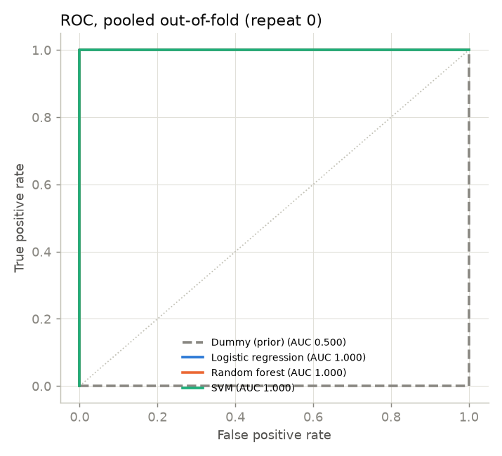 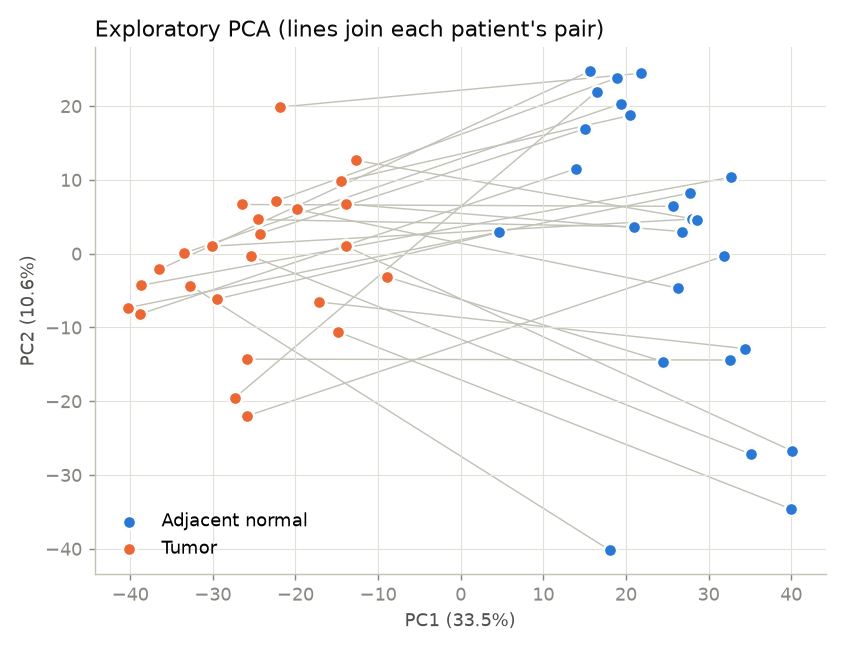</p>

### Differential expression (paired *t*-test, BH-FDR)

- **8,220** probes at FDR < 0.05; **830** also with |log2FC| ≥ 1 (**365 up**, **465 down** in tumor).
- Largest increases: *CST1* (+3.5), *MMP11* (+3.2), *OLR1*, *CXCL10*, *TOP2A*, *CXCL9*, *CKS2*, *TPX2*, *COL11A1*.
- Largest decreases: *FABP4* (−5.6), *FIGF*/*VEGFD* (−4.1), *ADIPOQ* (−4.1), *CHRDL1*, *ADH1B*, *LYVE1*, *CD36*.
- Composition check: fixed marker panels separate the tissues with no training at all, with an adipocyte
  score AUC of 0.98 (lower in tumor) and a proliferation score AUC of 0.98.

<p align="center">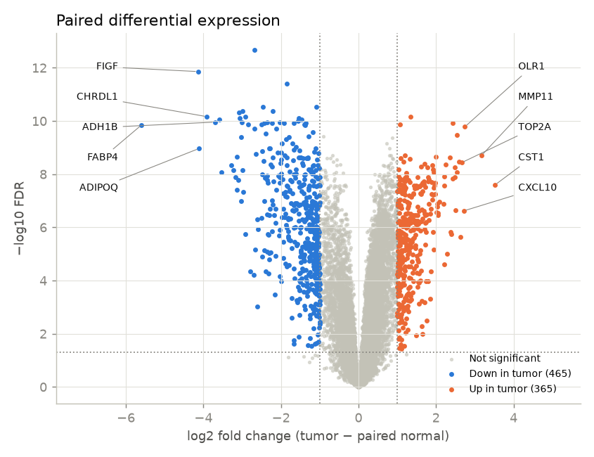 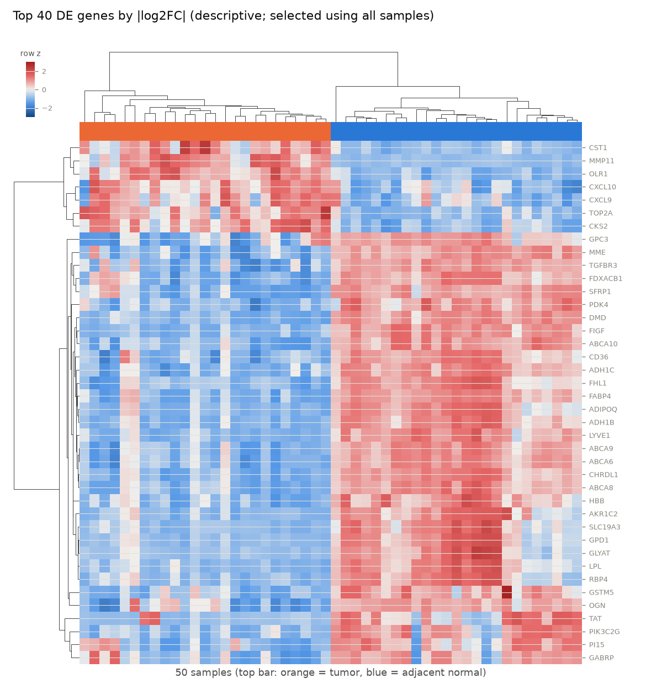</p>

### Pathways (ORA vs. 17,324 measured genes)

| Direction | Top terms (FDR) |
|---|---|
| Up in tumor (361 genes) | Reactome *Cell Cycle, Mitotic* (2e-23), *Cell Cycle Checkpoints* (5e-20), *Resolution of Sister Chromatid Cohesion* (6e-16); GO *Mitotic Sister Chromatid Segregation* (8e-15) |
| Down in tumor (461 genes) | GO *Regulation of Angiogenesis* (8e-6), *Regulation of Protein Kinase B Signaling* (1e-4), *Regulation of Cold-Induced Thermogenesis* (1e-4); Reactome *Signaling by Nuclear Receptors*, *Transcriptional Regulation of White Adipocyte Differentiation*, *ECM Organization* |

### Genes the models rely on

These are consistent across LR coefficients, held-out permutation importance and outer-fold selection stability:
*INHBA* (up), *C2orf40*/*ECRG4*, *DMD*, *FIGF*/*VEGFD*, *TFPI*, *SDPR*/*CAVIN2* and *ADH1B* (down). Most mark
stromal, vascular or adipose tissue, which is again consistent with composition-driven separation.

## Dashboard screenshots & demo

| | |
|---|---|
| 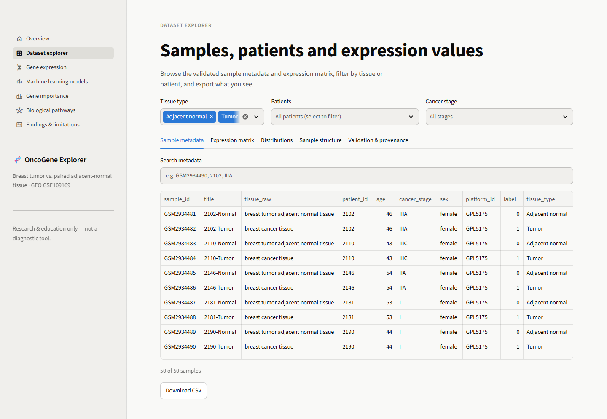 | 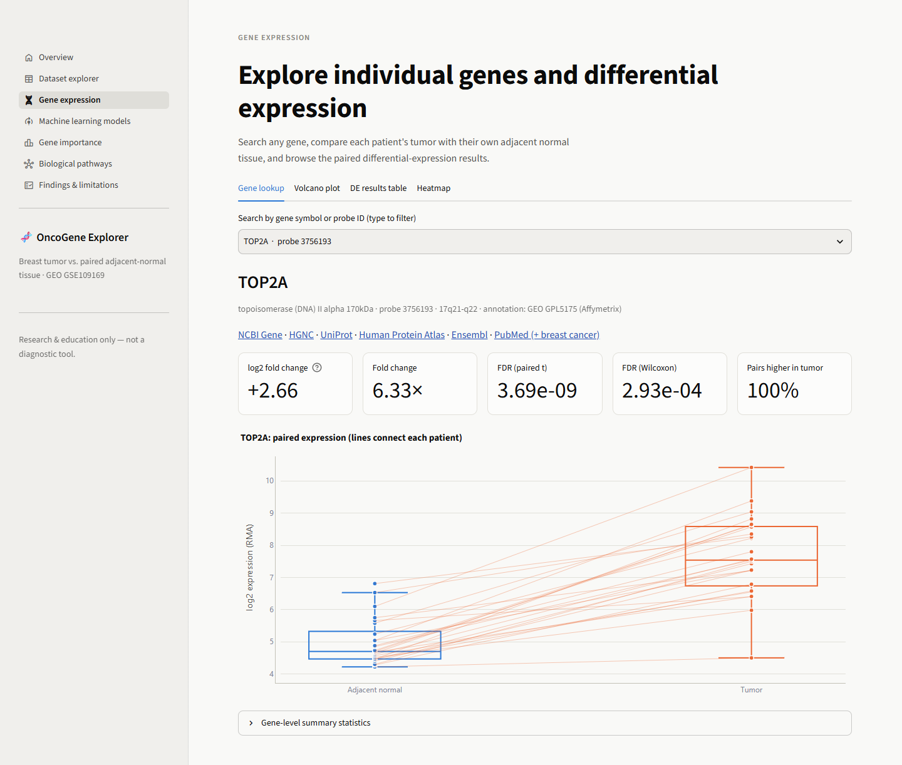 |
| 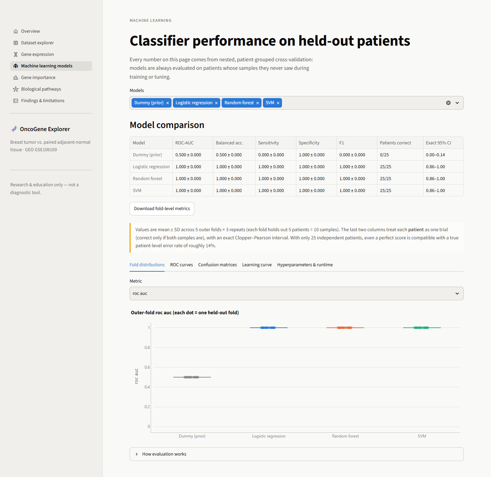 | 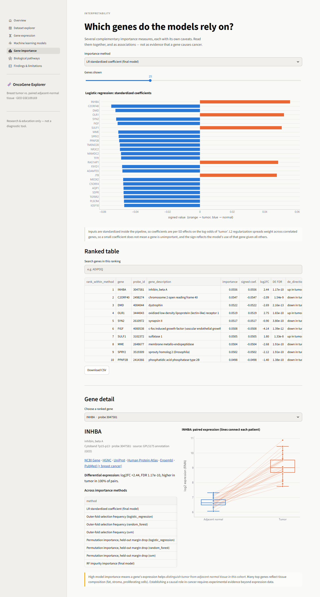 |
| 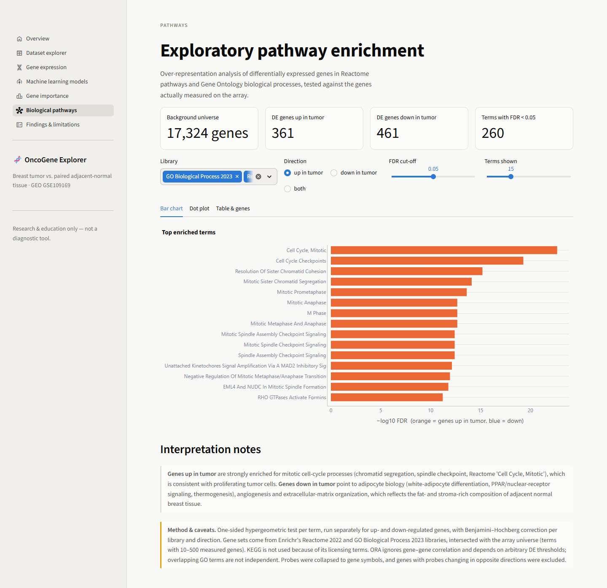 | 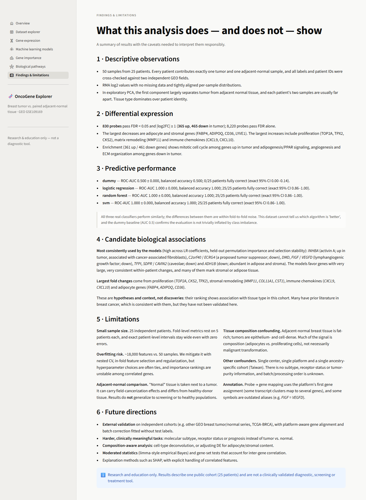 |

**Demo:** `docs/demo/oncogene_explorer_walkthrough.webm` is a recorded walkthrough of all seven pages. Regenerate
it with `python scripts/capture_screenshots.py --video` (requires `pip install playwright` and a local Chrome or Edge).

## Biological findings and limitations

**Findings (associations within this cohort):**

- **Up in tumor:** mitotic cell-cycle genes (*TOP2A*, *TPX2*, *MKI67*, *CCNB1*), matrix remodeling (*MMP11*,
  *COL11A1*, *COL10A1*, *INHBA*) and immune chemokines (*CXCL9*, *CXCL10*). Reactome "Cell Cycle, Mitotic" and
  GO chromosome-segregation and spindle-checkpoint terms are the most enriched.
- **Down in tumor:** adipocyte genes (*FABP4*, *ADIPOQ*, *PLIN1*, *LEP*, *CD36*), vascular and lymphatic genes
  (*LYVE1*, *FIGF*/*VEGFD*) and myoepithelial genes (*KRT5*). These are enriched for white-adipocyte
  differentiation, PPAR/nuclear-receptor signaling, angiogenesis and ECM organization.
- **Composition dominates.** Fixed literature marker panels separate the classes with no training at all:
  adipocyte score AUC 0.98 (lower in tumor), proliferation score AUC 0.98.

**Key limitations** (see **[docs/limitations.md](docs/limitations.md)**):

- Only 25 independent patients, from one center, one platform and one ancestry, with no external validation.
- The comparison is with *adjacent* normal tissue, which can carry field effects and differs from healthy tissue.
- Strong tissue-composition confounding, and unrecorded subtype, purity and batch information.
- Associations are not causation; predictive importance does not mean a gene drives cancer.
- Results do not support any screening, diagnostic or treatment use.

## Future improvements

- **External validation** on independent cohorts (other GEO tumor/normal series, TCGA-BRCA), with
  platform-aware gene alignment and batch correction fitted without test labels.
- **More meaningful prediction targets:** molecular subtype, receptor status or prognosis.
- **Composition-aware modeling:** cell-type deconvolution, or DE adjusted for adipocyte and stromal content.
- **Moderated statistics** (limma-style empirical Bayes) and correlation-aware gene-set tests (e.g. CAMERA, GSEA).
- **Explainability:** SHAP with explicit treatment of correlated features. **Deep learning:** a small MLP baseline with careful overfitting checks.
- **Deployment:** Streamlit Community Cloud. The app reads only public, derived artifacts.

## Testing

```bash
python -m pytest            # 50+ tests; data/dashboard tests auto-skip if artifacts are absent
python -m pytest -m "not data"   # fast, synthetic-only
```

Coverage includes GEO parsing; label and patient-ID mapping with cross-checks; matched-pair validation;
duplicate, missing and constant detection; log-scale detection; in-pipeline imputation; BH correction against
`statsmodels`; paired-*t* against SciPy; ORA math; grouped splitting (no shared patients, each patient tested
once per repeat, balanced folds, reproducibility); a **noise-data leakage test** (in-fold selection keeps AUC
near chance); model I/O shapes; metric calculations; exact CIs; permutation importance; model serialization;
and rendering of every dashboard page plus graceful handling of missing artifacts.

## Citations and acknowledgments

- **Dataset:** Chang JW, Kuo WH, Lin CM, Chen WL, Chan SH, Chiu MF, Chang IS, Jiang SS, Tsai FY, Chen CH,
  Huang PH, Chang KJ, Lin KT, Lin SC, Wang MY, Uen YH, Tu CW, Hou MF, Tsai SF, Shen CY, Tung SL, Wang LH.
  Wild-type p53 upregulates an early onset breast cancer-associated gene *GAS7* to suppress metastasis via
  GAS7–CYFIP1-mediated signaling pathway. *Oncogene* 2018;37(30):4137–4150.
  PMID [29706651](https://pubmed.ncbi.nlm.nih.gov/29706651/).
  GEO accession [GSE109169](https://www.ncbi.nlm.nih.gov/geo/query/acc.cgi?acc=GSE109169).
- **GEO:** Edgar R, Domrachev M, Lash AE. Gene Expression Omnibus: NCBI gene expression and hybridization array
  data repository. *Nucleic Acids Res* 2002;30:207–210.
- **Gene sets:** Reactome (Milacic M *et al.*, *Nucleic Acids Res* 2024), Gene Ontology (Gene Ontology
  Consortium, *Genetics* 2023), distributed via Enrichr (Kuleshov MV *et al.*, *Nucleic Acids Res* 2016).
- **Methods:** Benjamini Y, Hochberg Y. *J R Stat Soc B* 1995;57:289–300. Irizarry RA *et al.* (RMA),
  *Biostatistics* 2003;4:249–264. Varma S, Simon R. Bias in error estimation when using cross-validation
  for model selection. *BMC Bioinformatics* 2006;7:91.
- **Software:** pandas, NumPy, SciPy, scikit-learn, statsmodels, matplotlib, seaborn, Plotly, Streamlit.

Released under the [MIT License](LICENSE). The dataset remains subject to GEO and original-author terms.
